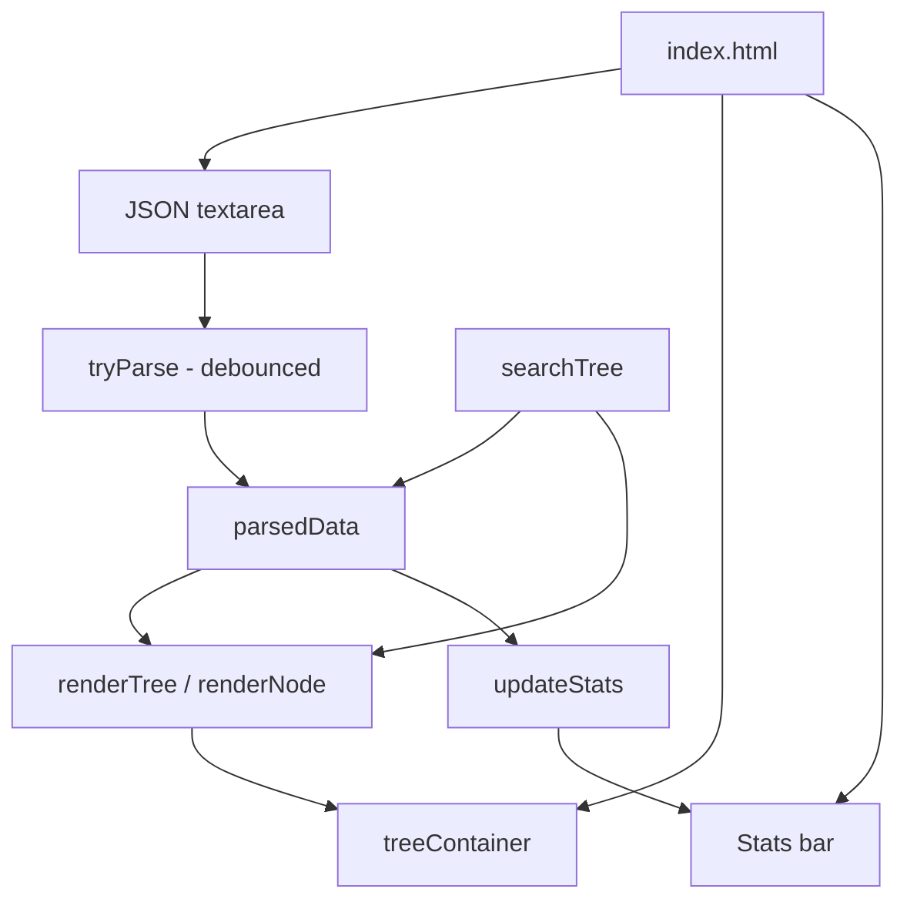

# JSON Tree Viewer - Architecture

## Overview

JSON Tree Viewer is an interactive developer tool for inspecting, exploring, and searching JSON documents in the browser. A collapsible tree shows the parsed value with syntax highlighting, while the toolbar exposes formatting, minification, search, path copying, and summary statistics.

The project is self-contained. It has no package manifest, no build step, and no runtime dependency outside the browser APIs available in modern engines.

## Purpose & Goals

- Parse a JSON document once and render it as a navigable tree.
- Let users collapse and expand individual nodes or the whole document.
- Search keys and values and jump to the first match.
- Expose the JSON path of a selected node so it can be reused in code or tooling.
- Provide format and minify actions for quick cleanup.
- Keep the implementation small enough to read and modify without a framework.

## Folder Structure

```text
json-tree-viewer/
|--  index.html          # Two-panel layout: input editor and tree view
|--  script.js           # Parser, tree renderer, search, copy, stats
|--  style.css           # Syntax highlighting, tree styling, responsive rules
|--  ARCHITECTURE.md     # This document
`--  thumbnail.svg       # Preview thumbnail used by the project registry
```

## System / Project Architecture Overview

The application is a single document with one imperative script. There is no router, store, or component framework. The input editor and the tree container are the two long-lived DOM regions, and `script.js` owns all state that connects them.



The script is intentionally loaded at the end of the body, so the element lookups at the top of the file run after the markup exists. All rendering is synchronous; the only scheduled work is the 300 ms parse debounce.

## Component Breakdown

| Component      | Responsibility                                                                                                                          |
| -------------- | --------------------------------------------------------------------------------------------------------------------------------------- |
| Input editor   | Accepts pasted or typed JSON. The `input` event schedules parsing and updates the byte counter.                                         |
| Parser         | Calls `JSON.parse` inside a try/catch, reports the error position, and stores the result in `parsedData`.                               |
| Tree renderer  | Walks the parsed value recursively and appends DOM nodes to a `DocumentFragment` before a single replacement of `treeContainer`.        |
| Search         | Performs a case-insensitive substring walk over keys and leaf values, then expands the ancestors of the first match.                    |
| Stats bar      | Reports the root type, key count, depth, byte size, and the currently selected path.                                                    |
| Path selection | Stores the path of the clicked line, highlights it, and copies it through `navigator.clipboard` with a `document.execCommand` fallback. |

## Data Flow / Execution Flow

1. The page loads with a sample document already present in the editor.
2. `tryParse()` runs once during initialization, then again 300 ms after every `input` event.
3. A successful parse replaces `parsedData`, clears the previous tree, and calls `renderTree()` and `updateStats()`.
4. `renderTree()` creates a `DocumentFragment`, calls `renderNode()` for the root at path `$`, and appends the finished fragment.
5. `renderNode()` emits one line per object or array, then recurses into children unless the path is present in `collapsedPaths`.
6. Clicking a toggle updates `collapsedPaths` and re-renders. Clicking a line calls `selectPath()`, which updates the stats bar and the `.selected` class.
7. Search walks the same data structure, records matching paths, expands ancestors with `expandPathTo()`, and re-renders so the matches can be highlighted.
8. Format and minify rewrite the editor value with `JSON.stringify` using two-space or zero-space indentation.

## Key Features

| Feature             | Description                                                                                       |
| ------------------- | ------------------------------------------------------------------------------------------------- |
| Collapsible tree    | Click a node to expand or collapse it. The toolbar can expand or collapse every node at once.     |
| Syntax highlighting | Keys are cyan, strings green, numbers amber, booleans purple, and null red.                       |
| Real-time parsing   | Input is parsed after a 300 ms debounce to avoid re-rendering on every keystroke.                 |
| Search              | Case-insensitive matching across keys and values, with match highlighting and ancestor expansion. |
| Path copying        | Click any line to select its JSON path, then copy it with the toolbar button.                     |
| Format and minify   | Pretty-print the current document or compress it to a single line.                                |
| Sample data         | Loads a realistic nested object for a quick demonstration.                                        |
| Stats bar           | Shows root type, key count, depth, byte size, and the selected path.                              |
| Keyboard shortcuts  | Ctrl+F focuses search and Escape clears it.                                                       |

## Technologies Used

- HTML5, CSS3, and vanilla ES6+ JavaScript.
- `JSON.parse` and `JSON.stringify` for parsing and formatting.
- `Blob` for byte-size measurement.
- `CSS.escape()` for safe attribute selectors when locating a rendered path.
- `navigator.clipboard` with a hidden textarea fallback for older browsers.

## File Responsibilities

### `index.html`

- Defines the two-panel layout: a textarea for input and a scrollable tree container.
- Contains the toolbar buttons for sample data, format, minify, expand all, collapse all, and copy path.
- Provides the search field, match counter, status line, and five statistics fields.
- Loads `style.css` and `script.js`; there are no third-party scripts.

### `script.js`

- **`tryParse()`** - validates the editor contents and reports meaningful parse errors.
- **`renderTree()` / `renderNode()`** - build the recursive tree and apply collapsed state from `collapsedPaths`.
- **`createLeafLine()`** - renders primitive values with the correct class for syntax coloring.
- **`toggleNode()` / `selectPath()`** - manage expansion state and the selected path.
- **`searchTree()` / `findMatches()` / `highlightSearch()`** - implement search and match highlighting.
- **`updateStats()` / `countKeys()` / `getDepth()`** - compute the summary shown in the stats bar.
- **`formatBytes()` / `updateInputSize()`** - report the UTF-8 byte size of the input.
- **`copyPath()`** - copies the selected path, preferring the async clipboard API and falling back to `execCommand`.

### `style.css`

- Implements the two-panel grid and the compact tree indentation.
- Defines the syntax colors, hover and selected states, and match highlighting.
- Contains the responsive breakpoint that stacks the editor above the tree on narrow screens.
- Uses CSS custom properties for the light and dark palettes.

### `thumbnail.svg`

- Static preview artwork referenced by the repository project registry. It is not loaded by the application itself.

## Design Decisions

- **Recursive DOM rendering**: A DOM tree keeps every node focusable and clickable without a virtual DOM or canvas hit-testing layer.
- **Collapsed state as paths**: Path strings in a `Set` give O(1) membership checks and survive re-renders without retaining node references.
- **Debounced parsing**: Waiting 300 ms prevents large documents from being parsed on every keystroke while still feeling immediate.
- **Path syntax**: Dot notation for objects and bracket notation for arrays (`$.features[0].name`) matches common JSONPath usage and is easy to paste into other tools.
- **Fragment batching**: The renderer builds a fragment first, so the visible tree is replaced once instead of once per node.
- **Escaped selectors**: `CSS.escape()` is required because keys can contain quotes, brackets, or other selector metacharacters.

## Dependencies

| Dependency              | Version          | How loaded    | Purpose                                   |
| ----------------------- | ---------------- | ------------- | ----------------------------------------- |
| Browser runtime         | Modern evergreen | Native        | Parsing, DOM, clipboard, and `CSS.escape` |
| Cradle project registry | n/a              | Local tooling | Discovers the project and its metadata    |

There are no npm packages, CDN scripts, fonts, or stylesheets required by this project.

## Future Improvements

- Add file drag-and-drop and a download button for the current document.
- Persist the last document and collapsed paths in `localStorage`.
- Support JSON Pointer and JSONPath output formats alongside dot notation.
- Virtualize very large arrays so tens of thousands of nodes do not create one DOM element each.
- Add next and previous match navigation to the search bar.
- Expose a read-only URL fragment that encodes the selected path for sharing.

## Known Limitations

- Rendering is fully eager for expanded nodes; a multi-megabyte document can create a large DOM and stall the main thread.
- Search is a simple case-insensitive substring match and does not support regular expressions or typed filters.
- Collapsed state and editor contents are not persisted across page reloads.
- The viewer accepts a single JSON value. JSON Lines and streaming documents are not supported.
- Clipboard access depends on browser permissions; the fallback path is best effort.
- There is no test harness in the project folder, so regressions are caught only by the repository-level smoke tests.

## Development Notes

- Open `index.html` directly in a browser. A local HTTP server is optional because the project has no modules or fetches.
- The tree assumes the root path is `$`; keep that convention when adding path-related features.
- `collapsedPaths` is deliberately not cleared on a new parse, which preserves expansion state while editing related documents.
- Use the project thumbnail dimensions and naming conventions described in `CONTRIBUTING.md` when replacing `thumbnail.svg`.
- Run `npm run validate:architecture` from the repository root after editing this file.

## License & Attribution

- **Project License:** MIT, inherited from the Cradle repository.
- **Third-Party Assets:** None. The sample JSON is authored for the project.

## References

- [JSON specification (RFC 8259)](https://www.rfc-editor.org/rfc/rfc8259)
- [MDN: JSON.parse](https://developer.mozilla.org/en-US/docs/Web/JavaScript/Reference/Global_Objects/JSON/parse)
- [MDN: CSS.escape](https://developer.mozilla.org/en-US/docs/Web/API/CSS/escape)
- [MDN: Clipboard API](https://developer.mozilla.org/en-US/docs/Web/API/Clipboard_API)
- [Cradle contribution guide](../../../CONTRIBUTING.md)
