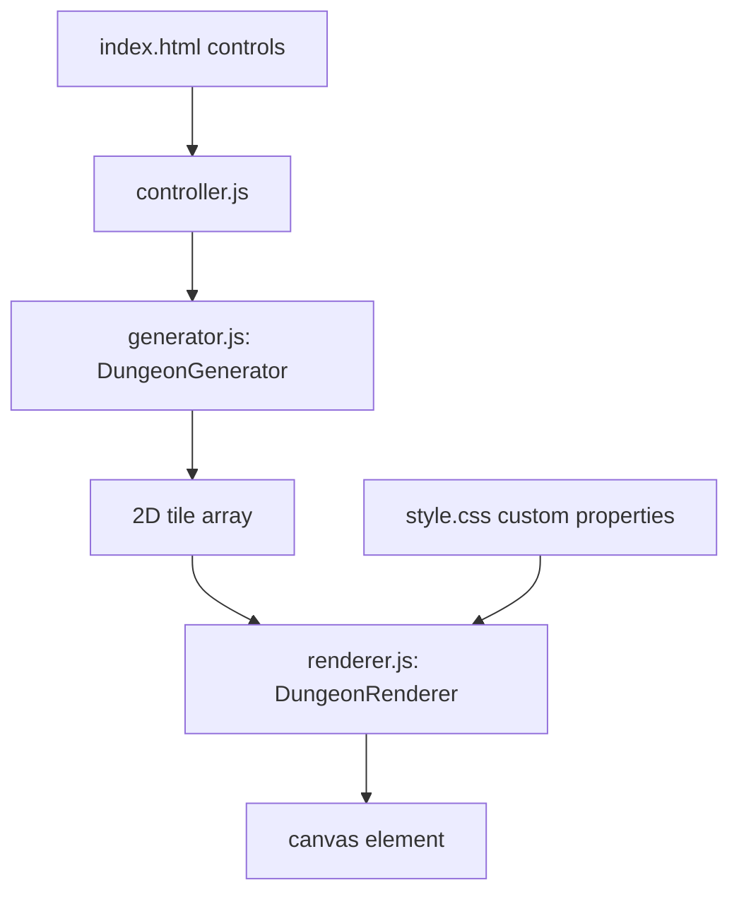

# Procedural Dungeon Generator - Architecture

## Overview

The Procedural Dungeon Generator builds randomized, tile-based dungeon layouts with Binary Space Partitioning (BSP) and renders them on an HTML5 canvas. Rooms are carved inside recursively split regions and connected with L-shaped corridors, producing a connected map that can be regenerated from a seed.

The project is a static page with ES modules. There is no package manifest and no build step; the browser loads the three source modules directly.

## Purpose & Goals

- Demonstrate procedural content generation with a readable BSP implementation.
- Expose the parameters that materially change the output: map size, minimum room size, and seed.
- Produce a deterministic layout when a seed is supplied, so a result can be reproduced or shared.
- Separate generation, rendering, and UI orchestration so each part can be changed independently.
- Keep the result visually inspectable, including doors that are inferred from the tile layout.

## Folder Structure

```text
procedural-dungeon-generator/
|--  index.html          # Parameter controls and the canvas element
|--  style.css           # Responsive layout and light/dark tile colors
|--  generator.js        # BSP tree, room carving, corridor connection, seeded RNG
|--  renderer.js         # Canvas 2D drawing and CSS variable color lookup
|--  controller.js       # DOM event binding and generation pipeline
|--  ARCHITECTURE.md     # This document
`--  thumbnail.svg       # Preview thumbnail used by the project registry
```

## System / Project Architecture Overview

The modules form a one-way pipeline. `controller.js` owns the DOM and the user interaction; `generator.js` owns the map data; `renderer.js` owns the canvas. Neither the generator nor the renderer reads form fields directly.



`controller.js` waits for `DOMContentLoaded`, reads the controls, constructs a generator, calls `generate()`, and hands the resulting array to the renderer. `renderer.js` resolves tile colors from CSS custom properties on every draw, which is what makes theme switches apply without a page reload.

## Component Breakdown

| Component          | Responsibility                                                                                                        |
| ------------------ | --------------------------------------------------------------------------------------------------------------------- |
| `BSPNode`          | Holds a rectangular region, its split children, and an optional room.                                                 |
| `DungeonGenerator` | Owns the tile array, performs recursive splits, places rooms, connects sibling regions, and exposes the finished map. |
| `DungeonRenderer`  | Sizes the canvas, maps tile values to colors, and paints floors, walls, start, end, and inferred doors.               |
| `controller.js`    | Reads the form, clamps invalid values, builds the generator, and triggers redraws.                                    |
| `index.html`       | Provides the width, height, minimum room size, and seed inputs plus the generate button.                              |
| `style.css`        | Defines the layout, canvas scaling, and the light/dark palette consumed by the renderer.                              |

## Data Flow / Execution Flow

1. The document finishes parsing and `controller.js` binds the generate button and input change handlers.
2. On a generate request, the controller reads width, height, minimum room size, and the optional seed.
3. `DungeonGenerator` creates a wall-filled 2D array and wraps the whole map in a root `BSPNode`.
4. The generator recursively splits each region along its longer axis until the region is too small or the depth limit is reached.
5. A room is placed inside each leaf region with randomized dimensions that respect the minimum room size.
6. Sibling leaves are connected with L-shaped corridors, which walks back up the tree and guarantees that every room is reachable.
7. Start and end markers are written into the tile array.
8. `DungeonRenderer` iterates the array, looks up the palette, and draws each tile as a filled rectangle. Door tiles are inferred from floor and wall adjacency at draw time.
9. The canvas is repainted on every generation and on theme changes that trigger a re-render.

## Key Features

- **Seeded output** - A small linear congruential generator drives every random decision, so the same seed and parameters produce the same map.
- **BSP room layout** - Recursive splitting produces rooms of varied size without overlapping.
- **Guaranteed connectivity** - Corridors are carved between sibling regions while the recursion unwinds.
- **Adjustable dimensions** - Width and height are clamped to a safe range before generation.
- **Minimum room size** - Controls how finely the space can be divided.
- **Canvas rendering** - Tiles are drawn as rectangles with a small inset, giving the map a crisp grid appearance.
- **Theme-aware palette** - Colors are read from CSS custom properties, so the same map renders correctly in light and dark mode.
- **Door inference** - The renderer detects narrow floor openings and draws them differently from ordinary floor tiles.

## Technologies Used

- HTML5 Canvas 2D API.
- Vanilla ES6+ JavaScript with native ES modules.
- CSS custom properties for theming.
- CSS Grid and flexbox for the control layout.

## File Responsibilities

### `index.html`

- Declares the control panel with labeled number inputs and a seed field.
- Hosts the canvas and the status text that reports the current seed.
- Loads `controller.js` as a module; the controller imports the other two modules.

### `generator.js`

- **`BSPNode`** - stores `x`, `y`, `width`, `height`, `left`, `right`, and `room`.
- **`DungeonGenerator`** - stores dimensions, minimum room size, RNG state, and the tile array.
- **`split()`** - chooses a split axis and position, then creates two child nodes.
- **`createRooms()`** - walks the tree and places a room in each leaf.
- **`connectRooms()`** - carves corridors between the rooms of sibling subtrees.
- **`generate()`** - resets the map, runs the pipeline, and returns the tile array.

### `renderer.js`

- **`DungeonRenderer`** - caches the canvas and 2D context and exposes `render(map)`.
- **`getColors()`** - reads the palette from computed styles so theme changes are picked up.
- **`drawTile()`** - paints one tile and applies the inset used to separate cells.
- **`isDoor()`** - inspects neighboring tiles to decide whether a floor tile should be drawn as a door.

### `controller.js`

- Binds the generate button and the parameter change handlers.
- Clamps width, height, and minimum room size to values the generator can handle.
- Normalizes an empty seed to `null` so the generator picks a random seed.
- Updates the seed display after generation.

### `style.css`

- Provides the responsive two-column layout that collapses on mobile.
- Defines the canvas border, background, and image rendering behavior.
- Declares the light and dark tile colors consumed by `renderer.js`.

### `thumbnail.svg`

- Static preview image used by the project registry. It is not part of the runtime.

## Design Decisions

- **Seeded LCG**: A linear congruential generator is small, deterministic, and adequate for layout decisions. It avoids shipping a random library and makes bug reports reproducible.
- **Rooms in leaves only**: Restricting rooms to leaf regions keeps placement simple and prevents overlaps without a collision pass.
- **Corridors after rooms**: Connecting sibling subtrees while unwinding guarantees connectivity without a separate graph search.
- **Door inference in the renderer**: The generator stays focused on passability. The renderer can change the visual treatment of doors without changing the map format.
- **CSS-driven colors**: Reading custom properties at draw time keeps the palette in one place and makes theme changes immediate.
- **Tile codes instead of objects**: An `Int8Array`-like 2D array is cheap to copy, inspect, and render, and it keeps the generator output easy to test.

## Dependencies

| Dependency              | Version          | How loaded    | Purpose                             |
| ----------------------- | ---------------- | ------------- | ----------------------------------- |
| Browser runtime         | Modern evergreen | Native        | ES modules, canvas, computed styles |
| Cradle project registry | n/a              | Local tooling | Discovers the project and thumbnail |

The project does not use npm packages, CDN assets, fonts, or external images.

## Future Improvements

- Add a downloadable PNG export of the current map.
- Support room templates such as circular chambers or corridors with variable width.
- Add a difficulty parameter that controls dead ends and corridor length.
- Show the BSP split lines as a debug overlay.
- Persist the last parameters in the URL query string for shareable links.
- Add a small test page that checks determinism and connectivity for a range of seeds.

## Known Limitations

- The generator produces a single dungeon per request and does not stream or animate the carving process.
- Connectivity is checked implicitly by construction; there is no explicit flood-fill validation in the UI.
- Very small maps can produce cramped corridors because the minimum room size is not automatically reduced.
- The start and end markers are placed after generation and are not guaranteed to be far apart.
- There is no collision handling for future entities such as enemies, chests, or doors.
- The canvas scales with CSS, so very large maps may look soft on high-DPI displays unless the backing store is resized.

## Development Notes

- Serve the folder over HTTP rather than opening `index.html` from disk; native ES modules are blocked by the `file://` origin in most browsers.
- Tile values are `0` for floor, `1` for wall, `2` for start, and `3` for end. Keep the renderer and generator in sync if a new value is added.
- The split depth limit is what prevents unbounded recursion on large maps. Adjust it together with the minimum room size.
- A seed of `null` means "pick a random seed"; the controller reports the chosen value so it can be reused.
- Run `npm run validate:architecture` from the repository root after editing this file.

## License & Attribution

- **Project License:** MIT, inherited from the Cradle repository.
- **Third-Party Assets:** None. The BSP implementation and thumbnail are original to the project.

## References

- [Binary space partitioning](https://en.wikipedia.org/wiki/Binary_space_partitioning)
- [MDN: Canvas API](https://developer.mozilla.org/en-US/docs/Web/API/Canvas_API)
- [MDN: JavaScript modules](https://developer.mozilla.org/en-US/docs/Web/JavaScript/Guide/Modules)
- [Cradle contribution guide](../../../CONTRIBUTING.md)
