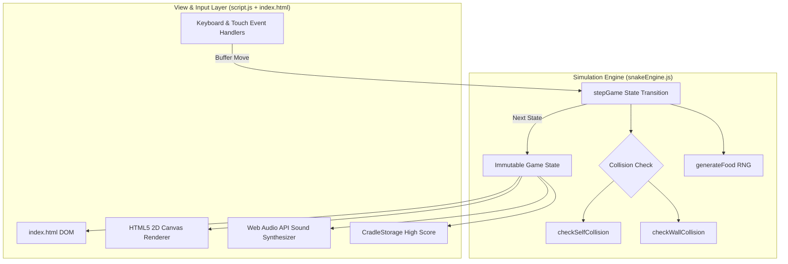

# Project Architecture

## Overview

Snake Game is a modern web-based arcade mini project built entirely with vanilla JavaScript and HTML5 Canvas. The player maneuvers an ever-growing serpent across a grid to eat fruit, accumulating points and increasing in body length while steering clear of walls and avoiding self-collision. It provides fluid gameplay, Web Audio API sound synthesis, dual control options (keyboard and touch D-Pad/swipes), and persistent high scores using `CradleStorage`.

---

## Purpose & Goals

- Recreate the classic retro snake arcade experience with responsive canvas graphics and dynamic neon styling.
- Deliver robust collision mechanics, specifically strict self-collision detection preventing the snake from passing through its own body (resolving Issue #998).
- Maintain complete separation of pure game simulation logic (`snakeEngine.js`) from presentation and DOM handlers (`script.js`) for deterministic Node.js unit testing.
- Adhere strictly to Cradle's mini-project architecture standards and storage policies (`CradleStorage`).

---

## Folder Structure

```text
projects/games/snake-game/
├── ARCHITECTURE.md     # Architectural design and specification documentation
├── index.html          # HTML5 UI shell, HUD layout, and modal overlays
├── script.js           # Canvas rendering loop, audio effects, and user event listeners
├── snakeEngine.js      # Pure state transition engine and collision detection rules
├── style.css           # Arcade theme styles, responsive canvas wrapper, and mobile controls
└── thumbnail.svg       # Vector preview artwork for the Cradle project gallery
```

---

## System / Project Architecture Overview

The mini follows a decoupled Model-View-Controller architecture without external framework dependencies:



1. **State Engine (`snakeEngine.js`)**: Encapsulates pure state calculations (`createInitialState`, `stepGame`, `checkSelfCollision`, `checkWallCollision`, `generateFood`). It does not reference `window`, `document`, or DOM elements.
2. **Controller & Renderer (`script.js`)**: Coordinates the `requestAnimationFrame` game loop, synchronizes user input queues, renders the board on the Canvas context, generates audio sound effects, and updates the HUD.
3. **Storage (`CradleStorage`)**: Safely stores and retrieves high scores across sessions using Cradle's standardized storage interface.

---

## Component Breakdown

| File             | Responsibility                                                                   |
| ---------------- | -------------------------------------------------------------------------------- |
| `index.html`     | Semantic markup, metadata, canvas container, score HUD, and game-over modal      |
| `snakeEngine.js` | Pure game mechanics, collision detection, movement stepping, and food generation |
| `script.js`      | Animation loop, canvas draw calls, Web Audio sound effects, and input listeners  |
| `style.css`      | Cyberpunk arcade styling, responsive canvas sizing, and mobile D-Pad layout      |
| `thumbnail.svg`  | Scalable vector graphic representing the game in Cradle's mini catalog           |

---

## Data Flow / Execution Flow

```text
User opens index.html
↓
Browser loads style.css, BackToHome.js, storage.js, snakeEngine.js, script.js
↓
DOMContentLoaded initializes canvas, binds buttons, loads high score from CradleStorage
↓
User clicks "Start" or presses Space/Arrow key
↓
Game loop (requestAnimationFrame) ticks at the selected difficulty speed
↓
stepGame executes in snakeEngine:
  - Validates direction change
  - Computes next head position
  - Runs checkSelfCollision & checkWallCollision
  - Checks food consumption and grows snake body
  - Spawns new food on unoccupied grid cell if consumed
↓
If collision occurs:
  - Sets isGameOver = true with specific deathReason ("self" or "wall")
  - Triggers game-over audio sound
  - Displays Game Over modal with score summary
↓
Canvas renders updated snake, food, and grid; HUD updates DOM scores
```

---

## Key Features

- **Precise Self-Collision Detection**: Prevents the snake from crossing or passing through any segment of its own body, immediately ending the game with clear feedback.
- **Direction Reversal Guard**: Rejects instant 180-degree reversal inputs that would cause immediate self-collision.
- **Buffered Input System**: Queues up to two directional inputs per tick, ensuring quick corner turns execute reliably without input drops.
- **Web Audio API Synthesis**: Generates dynamic retro sound blips for eating fruit, turning, and game-over crashes without loading audio files.
- **Dual Mobile Controls**: Provides both an on-screen directional pad (D-Pad) and touch swipe gesture recognition for mobile and tablet players.
- **Persistent High Scores**: Stores top scores in local storage via Cradle's secure `CradleStorage` contract.
- **Configurable Speed Modes**: Easy, Medium, and Hard difficulty presets.

---

## Technologies Used

| Technology                | Purpose                                                                     |
| ------------------------- | --------------------------------------------------------------------------- |
| HTML5                     | Canvas element, accessible semantic structure, and modal dialogues          |
| CSS3 (Flexbox & Grid)     | Responsive arcade presentation, neon glows, and mobile D-Pad styling        |
| Vanilla JavaScript (ES6+) | Game state management, input handling, and canvas rendering                 |
| HTML5 Canvas API          | High-performance 2D drawing of snake segments, glowing food, and grid lines |
| Web Audio API             | Client-side procedural audio synthesis for sound effects                    |
| CradleStorage             | Local persistence of player high scores across browsing sessions            |

---

## File Responsibilities

### `index.html`

- Houses the `#gameCanvas` (400×400 resolution) inside a responsive wrapper.
- Renders the stats HUD (`#scoreValue`, `#highScoreValue`, `#lengthValue`).
- Hosts the `#gameOverModal` displaying the `#deathReason` and restart actions.
- Provides touch controls (`#dpadUp`, `#dpadDown`, `#dpadLeft`, `#dpadRight`).

### `snakeEngine.js`

- `createInitialState(options)`: Instantiates fresh game state with default 3-segment snake centered on grid.
- `isValidDirectionChange(currentDir, nextDir)`: Rejects 180° immediate reversal moves.
- `checkWallCollision(position, gridSize)`: Evaluates if position is outside bounds `[0, gridSize - 1]`.
- `checkSelfCollision(nextHead, body, willGrow)`: Checks if the new head coordinate overlaps any existing body segment.
- `generateFood(snake, gridSize, randomFn)`: Locates an empty cell not occupied by the snake.
- `stepGame(state, randomFn)`: Pure deterministic transition advancing the state by one frame.

### `script.js`

- `gameTick(currentTime)`: Manages timestamp diffs against selected speed interval.
- `render()`: Draws grid, glowing apple with radial gradient, snake head with direction-sensitive eyes, and segmented body.
- `playSound(type)`: Synthesizes oscillators (`sine`, `sawtooth`, `triangle`) for game audio.
- `requestDirection(dir)`: Buffers valid directional keypresses.
- Event listeners for arrow keys, WASD, touch swipes, and button actions.

### `style.css`

- Defines dark neon theme variables (`--bg-color`, `--accent-color`, `--danger-color`).
- Keeps the canvas aspect ratio locked and responsive.
- Hides the D-Pad on desktop screens (`@media (min-width: 641px)`).
- Styles the game-over modal with backdrop blur.

---

## Design Decisions

- **Pure Functional Simulation Engine**: Isolating `snakeEngine.js` with zero DOM or browser API dependencies enables comprehensive Node.js unit testing with 100% test coverage.
- **UMD Compatibility**: `snakeEngine.js` exports as CommonJS (`module.exports`) when loaded in Node.js test runners and attaches to `window.SnakeEngine` in the browser.
- **Input Buffering**: Fast double-tap direction inputs (e.g., Right then Down) are queued up to 2 commands, eliminating the common retro game bug where fast consecutive inputs get swallowed.
- **Safe Procedural Audio**: Procedural oscillator synthesis with gain ramp-downs eliminates external audio asset loading errors and obeys browser audio autoplay policies.

---

## Dependencies

| Dependency             | Version | How loaded                     | Purpose                                     |
| ---------------------- | ------- | ------------------------------ | ------------------------------------------- |
| Cradle `BackToHome.js` | —       | Local `<script defer>`         | Consistent navigation back to Cradle portal |
| Cradle `storage.js`    | —       | Local `<script>`               | Validated persistence via `CradleStorage`   |
| Outfit Font            | —       | System fallback / Google Fonts | Clean modern arcade typography              |

---

## Future Improvements

- Add obstacle / maze modes with inner barriers.
- Implement special power-up food types (speed boost, double points, ghost mode).
- Add particle explosion effects on game over.
- Introduce local two-player split-screen or duel mode.

---

## Known Limitations

- Audio requires an initial user interaction (click/touch/key) to unlock the Web Audio `AudioContext` as required by browser autoplay restrictions.
- Grid resolution is fixed to 20×20 units.

---

## Development Notes

- Unit tests for the engine can be run directly using Node.js:
  ```bash
  node --test tests/snake-game.test.js
  ```
- No build step or bundler is required. Opening `index.html` via any local HTTP server runs the game immediately.

---

## License & Attribution

- **Project License:** MIT (part of the Cradle repository)
- **Third-Party Assets:** None. All visual graphics, vector thumbnails, and procedural audio effects are created natively.

---

## References

- [MDN Web Docs — Canvas API](https://developer.mozilla.org/en-US/docs/Web/API/Canvas_API)
- [MDN Web Docs — Web Audio API](https://developer.mozilla.org/en-US/docs/Web/API/Web_Audio_API)
- [GitHub Issue #998: Snake game — snake passes through its own body without triggering game over](https://github.com/Facelessism/cradle/issues/998)
