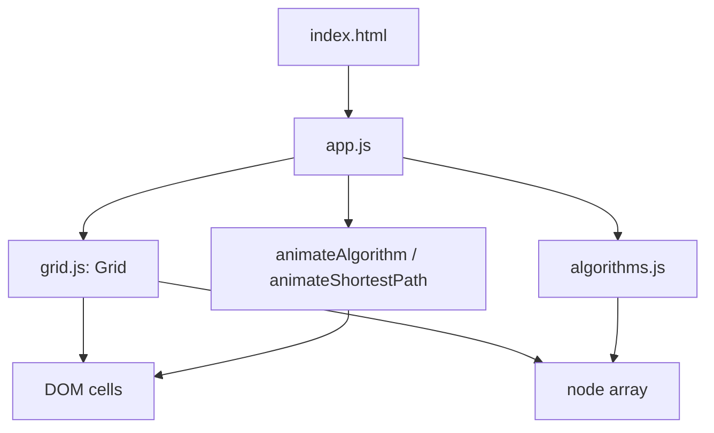

# Pathfinding Algorithm Visualizer - Architecture

## Overview

The Pathfinding Algorithm Visualizer is a browser tool for comparing BFS, Dijkstra, and A* on the same grid. Users draw walls, move the start and end nodes, choose an algorithm and animation speed, and watch the search frontier expand before the shortest path is traced.

The project uses native ES modules and plain DOM nodes for the grid. There is no build step and no external library.

## Purpose & Goals

- Show how different algorithms explore the same graph and why the visited sets differ.
- Provide direct manipulation for walls, start, end, and maze generation.
- Animate traversal at a speed the user can follow without freezing the page.
- Keep the algorithm functions pure and independent from the DOM so they are easy to reason about and test.
- Remain accessible and responsive on desktop and mobile.

## Folder Structure

```text
pathfinding-visualizer/
|--  index.html          # Controls, legend, and grid container
|--  style.css           # Responsive layout, grid cells, and state animations
|--  app.js              # DOM events, algorithm selection, animation sequencing
|--  grid.js             # Grid model, DOM cell creation, wall and node dragging
|--  algorithms.js       # BFS, Dijkstra, A*, neighbor helpers, path reconstruction
|--  ARCHITECTURE.md     # This document
`--  thumbnail.svg       # Preview thumbnail used by the project registry
```

## System / Project Architecture Overview

The grid has two representations that are kept in sync: a two-dimensional array of node objects and a matching two-dimensional array of DOM cells. `grid.js` owns both. `algorithms.js` reads the node array without touching the DOM. `app.js` is the coordinator that binds controls, invokes an algorithm, and schedules the animation.



Because the algorithm functions mutate `isVisited`, `distance`, and `previousNode` on the node objects, the grid is recreated or reset between runs. The visual classes are applied later by the animation, not by the algorithm itself.

## Component Breakdown

| Component       | Responsibility                                                                                                         |
| --------------- | ---------------------------------------------------------------------------------------------------------------------- |
| `Grid`          | Creates the node array and DOM cells, connects mouse and touch-style drag handlers, and exposes start and end lookups. |
| `algorithms.js` | Implements BFS with a queue, Dijkstra with a distance-sorted list, and A* with a heuristic and open set.               |
| `app.js`        | Reads the selected algorithm and speed, resets visual state, runs the algorithm, and animates the result.              |
| `index.html`    | Provides the algorithm selector, speed selector, generate, clear path, and clear grid buttons, plus the legend.        |
| `style.css`     | Defines the grid layout, wall and visited colors, path animation, and responsive cell sizing.                          |

## Data Flow / Execution Flow

1. `DOMContentLoaded` fires and `app.js` creates a `Grid` with 20 rows and 40 columns.
2. `Grid` builds the DOM cells, assigns each node its row and column, and marks the start and end nodes.
3. A user drags across cells. `grid.js` toggles the `isWall` flag and the `.wall` class, skipping the start and end nodes.
4. A user selects an algorithm and speed and presses Visualize.
5. `app.js` clears the previous visualization, snapshots the start and end nodes, and calls the selected algorithm.
6. The algorithm returns `{ visitedNodesInOrder, shortestPathNodes }`. If the end node was never reached, the shortest path is empty.
7. `animateAlgorithm()` awaits a short delay between visited nodes, adding the `.visited` class in order.
8. `animateShortestPath()` then adds the `.path` class along the reconstructed route.
9. Clear Path removes only visit and path classes, preserving walls. Clear Grid removes walls and restores the default start and end positions.

## Key Features

- **Three algorithms** - BFS, Dijkstra, and A* share the same node model and return shape.
- **Wall drawing** - Drag across the grid to add or remove walls.
- **Movable endpoints** - Drag the start and end nodes to a new cell.
- **Maze generation** - Randomized wall placement produces a fresh obstacle layout while keeping the endpoints clear.
- **Speed control** - A selector sets the delay between visited nodes for the next run.
- **Path reconstruction** - Each algorithm records `previousNode`, and a shared helper walks it back from the end node.
- **Status messages** - An `aria-live` status line reports when no path exists and when the search is complete.
- **Native controls** - The toolbar uses real buttons and selects, so it works with keyboard navigation out of the box.

## Technologies Used

- HTML5, CSS3, and vanilla ES6+ JavaScript.
- CSS Grid for the cell layout.
- CSS transitions and keyframe animations for the visited and path states.
- `setTimeout` and promises for animation pacing.
- Native ES modules for source organization.

## File Responsibilities

### `index.html`

- Declares the control bar: algorithm select, speed select, generate maze, clear path, and clear grid.
- Hosts the grid container and the status message.
- Includes the legend that explains wall, visited, path, start, and end colors.
- Loads `app.js` as a module.

### `grid.js`

- **`Grid`** - stores rows, columns, container id, the node matrix, and the drag state.
- **`createGrid()`** - builds cells, assigns `dataset.r` and `dataset.c`, and attaches the start and end markers.
- **`attachEventListeners()`** - handles mousedown, mouseover while dragging, and document mouseup.
- **`toggleWall()`** - flips a node between wall and floor while protecting the endpoints.
- **`resetGrid()` / `clearPath()`** - restore walls or remove only the visualization classes.
- **`getStartNode()` / `getEndNode()`** - locate the endpoints without scanning the DOM.

### `algorithms.js`

- **`bfs()`** - level-order search with a queue; optimal for unweighted grids.
- **`dijkstra()`** - repeatedly takes the closest unvisited node and relaxes its neighbors.
- **`astar()`** - like Dijkstra but orders the open set by distance plus Manhattan heuristic.
- **`getNodesInShortestPathOrder()`** - walks `previousNode` from the end node back to the start.
- **`getUnvisitedNeighbors()`** - returns in-bounds, non-wall, unvisited neighbors.
- **`updateUnvisitedNeighbors()`** - assigns distance and predecessor for Dijkstra and A*.

### `app.js`

- Binds the controls and guards against starting a second run while one is animating.
- Resets node state before each run so previous distances do not leak into the next algorithm.
- Converts the speed selector into a millisecond delay.
- Reports the result in the status line and handles the no-path case.

### `style.css`

- Lays out the control bar and the fixed-ratio grid.
- Defines the wall, visited, path, start, and end colors for both themes.
- Uses `animation: pop` on visited cells to make the traversal direction readable.
- Shrinks cell gaps and control widths at narrow viewports.

### `thumbnail.svg`

- Static preview artwork for the project registry and not part of the runtime.

## Design Decisions

- **DOM cells instead of canvas**: CSS classes and transitions give accessible elements and readable state without a custom canvas renderer.
- **Pure-ish algorithms**: The search functions receive a grid and return ordered arrays. They mutate node bookkeeping, but they do not create DOM nodes, which keeps them portable.
- **Shared return shape**: Every algorithm returns `visitedNodesInOrder` and `shortestPathNodes`, so the animation layer does not branch by algorithm.
- **Previous-node reconstruction**: Storing a predecessor pointer is cheaper than keeping a separate parent map and works for all three searches.
- **Animation in the controller**: The algorithms finish immediately; pacing is a presentation concern owned by `app.js`.
- **Manhattan heuristic**: A* uses a grid-appropriate heuristic that is admissible for four-direction movement.

## Dependencies

| Dependency              | Version          | How loaded    | Purpose                             |
| ----------------------- | ---------------- | ------------- | ----------------------------------- |
| Browser runtime         | Modern evergreen | Native        | ES modules, DOM, CSS Grid, timers   |
| Cradle project registry | n/a              | Local tooling | Discovers the project and thumbnail |

There are no npm packages, CDN scripts, fonts, or images required at runtime.

## Future Improvements

- Add weighted terrain so Dijkstra and A* produce visibly different routes from BFS.
- Show a live comparison of visited counts and path lengths for each algorithm.
- Support touch drawing on tablets and phones.
- Add diagonal movement with an appropriate heuristic.
- Pause, resume, and step controls for the animation.
- Extract the algorithm tests into a small runner that checks path length and reachability on fixed grids.

## Known Limitations

- The grid is fixed at 20 by 40 cells; there is no size control in the UI.
- Dijkstra sorts the unvisited list on every iteration, which is acceptable at this grid size but not efficient for large graphs.
- A* uses a simple Manhattan heuristic and does not support weighted cells.
- The animation uses timers rather than `requestAnimationFrame`, so very fast speeds can still queue many callbacks.
- Dragging is mouse-oriented; touch support depends on the browser translating touch events to mouse events.
- There is no persistence of walls or settings between page loads.

## Development Notes

- Serve the folder over HTTP; native ES modules do not load from `file://` in most browsers.
- Keep the node shape stable. The algorithms rely on `r`, `c`, `isWall`, `isVisited`, `distance`, `previousNode`, `isStart`, and `isEnd`.
- Reset `isVisited`, `distance`, and `previousNode` before every run. Reusing stale state is the most common source of incorrect paths.
- The start and end nodes must never become walls; `toggleWall()` enforces this.
- Run `npm run validate:architecture` from the repository root after editing this file.

## License & Attribution

- **Project License:** MIT, inherited from the Cradle repository.
- **Third-Party Assets:** None. The algorithms, UI, and thumbnail are original to the project.

## References

- [A* search algorithm](https://en.wikipedia.org/wiki/A*_search_algorithm)
- [Dijkstra's algorithm](https://en.wikipedia.org/wiki/Dijkstra%27s_algorithm)
- [Breadth-first search](https://en.wikipedia.org/wiki/Breadth-first_search)
- [MDN: CSS Grid Layout](https://developer.mozilla.org/en-US/docs/Web/CSS/CSS_Grid_Layout)
- [Cradle contribution guide](../../../CONTRIBUTING.md)
