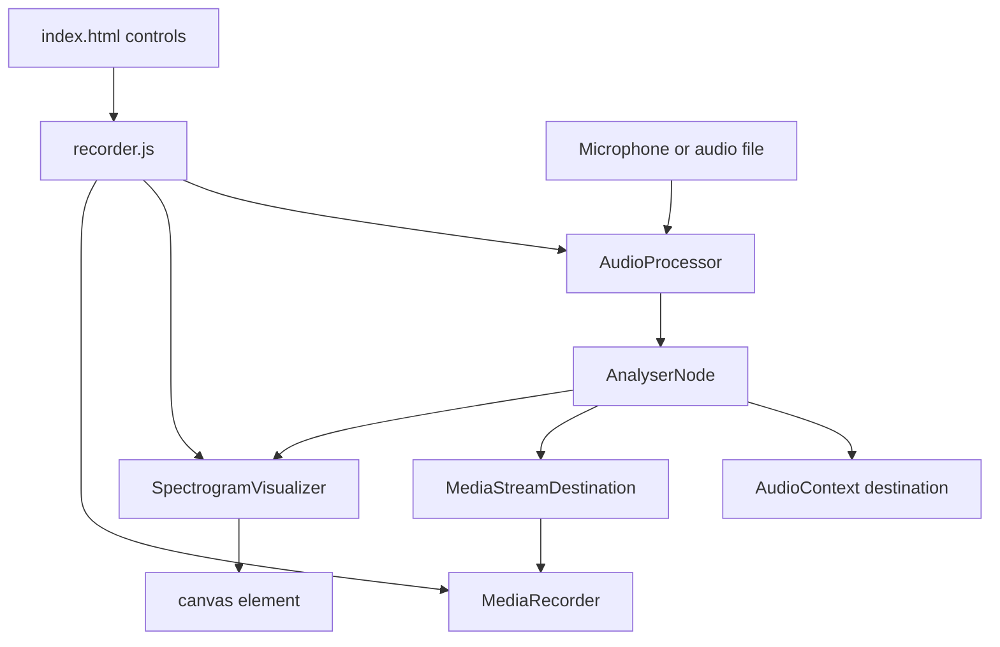

# Real-time Audio Spectrogram Analyzer - Architecture

## Overview

The Audio Spectrogram Analyzer captures audio from a microphone or a local file, routes it through the Web Audio API, and draws a scrolling time-frequency heatmap on a canvas. The same processed signal can be recorded locally and downloaded as a WebM file.

The application is a static collection of ES modules. It has no build step and no backend; microphone capture and recording happen entirely in the browser.

## Purpose & Goals

- Demonstrate real-time audio analysis with `AnalyserNode` and `getByteFrequencyData`.
- Render a readable spectrogram at animation speed without allocating a full history buffer every frame.
- Support both live microphone input and local audio files.
- Record the exact signal being visualized through a `MediaStreamDestination`.
- Fail gracefully when the microphone is unavailable or permission is denied.

## Folder Structure

```text
audio-spectrogram-analyzer/
|--  index.html          # Controls, canvas, error banner, and recording buttons
|--  style.css           # Responsive layout, dark/light theme, colormap legend
|--  audio-processor.js  # AudioContext, source routing, analyser, and stream cleanup
|--  visualizer.js       # Canvas scrolling heatmap and Magma-style colormap
|--  recorder.js         # MediaRecorder integration and application bootstrap
|--  ARCHITECTURE.md     # This document
`--  thumbnail.svg       # Preview thumbnail used by the project registry
```

## System / Project Architecture Overview

The application is split into three objects with narrow responsibilities. `AudioProcessor` owns the Web Audio graph, `SpectrogramVisualizer` owns the canvas loop, and `recorder.js` owns the DOM and the `MediaRecorder`.



The analyser is connected to both the speaker destination and a `MediaStreamDestination`, so the visualization and the recording see the same samples. The visualizer never reads from the microphone directly; it asks the processor for the latest frequency array.

## Component Breakdown

| Component               | Responsibility                                                                                                                            |
| ----------------------- | ----------------------------------------------------------------------------------------------------------------------------------------- |
| `AudioProcessor`        | Creates the `AudioContext`, obtains a microphone stream or an `<audio>` element source, and wires the analyser and recording destination. |
| `SpectrogramVisualizer` | Owns the canvas size, the colormap, and the `requestAnimationFrame` loop that shifts and repaints the heatmap.                            |
| `recorder.js`           | Binds controls, starts and stops `MediaRecorder`, creates the download blob, and stops audio resources on unload.                         |
| `index.html`            | Provides microphone, file, record, stop, and FFT size controls plus the canvas and error banner.                                          |
| `style.css`             | Defines the responsive layout, theme palette, and the legend that explains the colormap.                                                  |

## Data Flow / Execution Flow

1. `DOMContentLoaded` creates one `AudioProcessor` and one `SpectrogramVisualizer`, then binds the controls.
2. A microphone request calls `startMicrophone()`, which lazily creates the `AudioContext`, resumes it if suspended, and awaits `getUserMedia`.
3. The resulting `MediaStream` becomes a `MediaStreamAudioSourceNode`, which is connected to a new `AnalyserNode`.
4. A file request calls `loadAudioFile()`, which stops the previous source, creates an `<audio>` element with an object URL, and wraps it with `createMediaElementSource`.
5. `setupAnalyser()` sets the FFT size and smoothing, then connects the source to the analyser, the speakers, and the recording destination.
6. The visualizer loop calls `getFrequencyData()` on every frame. The analyser fills a `Uint8Array` with values from 0 to 255.
7. The visualizer copies the current canvas to a temporary canvas, shifts it left by 2 pixels, and draws the new frequency column on the right edge.
8. Recording creates a `MediaRecorder` around the destination stream. On stop, the chunks are combined into a Blob and downloaded.
9. On unload or an explicit stop, the processor stops microphone tracks, pauses the audio element, and disconnects the source; the visualizer clears its running flag.

## Key Features

- **Live microphone input** - Requests audio permission and reports a visible error if access is denied.
- **Local file input** - Loads an audio file, loops it, and analyzes it through the same graph.
- **Scrolling spectrogram** - A 2-pixel column per frame produces a stable time axis without storing the full history.
- **Magma-style colormap** - A precomputed 256-entry RGBA table avoids per-pixel interpolation during the render loop.
- **Adjustable FFT size** - The analyser can switch between the supported FFT sizes at runtime.
- **Local recording** - Records the analyzed signal to WebM and downloads it on stop.
- **Theme support** - The page and legend follow the Cradle light and dark tokens.
- **Cleanup on unload** - Stops tracks and animation when the page is closed.

## Technologies Used

- Web Audio API: `AudioContext`, `AnalyserNode`, `MediaStreamAudioSourceNode`, `MediaElementAudioSourceNode`, `MediaStreamDestination`.
- Media Capture and Streams API: `getUserMedia`.
- MediaRecorder API with `audio/webm` feature detection.
- HTML5 Canvas 2D API with `drawImage` and `fillRect`.
- `requestAnimationFrame` for the render loop.
- Vanilla ES6+ JavaScript modules.

## File Responsibilities

### `index.html`

- Declares the microphone, file, record, and stop buttons plus the FFT size selector.
- Hosts the spectrogram canvas, the color legend, and the hidden error banner.
- Loads `recorder.js` as a module, which imports the other two modules.

### `audio-processor.js`

- **`init()`** - creates the `AudioContext` and the recording destination.
- **`startMicrophone()`** - acquires a stream, builds the source node, and configures the analyser.
- **`loadAudioFile()`** - stops the previous source, creates an audio element, and connects it to the graph.
- **`setupAnalyser()`** - sets `fftSize` and smoothing and connects the analyser to speakers and recording.
- **`setFFTSize()`** - applies a new FFT size to the existing analyser.
- **`getFrequencyData()`** - returns the current byte frequency array, or an empty array when no analyser exists.
- **`getRecordingStream()`** - exposes the destination stream for `MediaRecorder`.
- **`stop()`** - stops microphone tracks, pauses the audio element, and disconnects the source.

### `visualizer.js`

- **`resizeCanvas()`** - sizes the backing store from the parent element's bounding box.
- **`buildColormap()`** - interpolates the Magma color stops into a 256-entry lookup table.
- **`start()` / `stop()`** - toggles the animation loop.
- **`draw()`** - shifts the previous frame, maps each frequency bin to a color, and schedules the next frame.

### `recorder.js`

- Creates the processor and visualizer and wires every control.
- Starts and stops `MediaRecorder`, chooses a supported MIME type, and downloads the result.
- Stops the visualizer and processor on `beforeunload`.

### `style.css`

- Provides the responsive control layout and canvas frame.
- Defines the light and dark surfaces, text colors, and legend gradient.
- Keeps the canvas at a stable aspect ratio so the time axis remains readable.

### `thumbnail.svg`

- Static preview artwork for the project registry and not part of the application.

## Design Decisions

- **Analyser in the middle of the graph**: Connecting the source to the analyser and the analyser to both outputs keeps visualization and recording on the same signal path.
- **Precomputed colormap**: A `Uint8ClampedArray` with 256 RGBA entries makes the per-bin color lookup constant time and avoids gradient math in the hot loop.
- **Scrolling by canvas copy**: Redrawing one column and shifting the previous image is much cheaper than retaining and repainting a large history buffer.
- **Direct frequency data**: `getByteFrequencyData` returns values already normalized to 0-255, which maps naturally to the colormap.
- **Recording from a destination stream**: `MediaStreamDestination` captures the processed signal rather than relying on a second microphone permission.
- **Feature detection**: The recorder checks `MediaRecorder.isTypeSupported` and falls back to the default MIME type when WebM is unavailable.

## Dependencies

| Dependency              | Version          | How loaded    | Purpose                                   |
| ----------------------- | ---------------- | ------------- | ----------------------------------------- |
| Browser runtime         | Modern evergreen | Native        | Web Audio, MediaRecorder, canvas, modules |
| Cradle project registry | n/a              | Local tooling | Discovers the project and thumbnail       |

The project has no npm packages, CDN scripts, fonts, or external assets. A secure context (`https` or `localhost`) is required for microphone access in most browsers.

## Future Improvements

- Add a frequency axis with labeled ticks and a time axis in seconds.
- Add a gain slider and a frequency range selector.
- Export the spectrogram itself as a PNG in addition to the audio recording.
- Use an `OffscreenCanvas` worker for very large FFT sizes.
- Add a pause control that freezes the heatmap without stopping audio.
- Support drag-and-drop for audio files.
- Add automated tests for colormap generation and frequency-to-pixel mapping.

## Known Limitations

- The spectrogram has no labeled axes; the legend explains color but not exact frequency or time values.
- The canvas is copied to a temporary canvas on every animation frame, which allocates a new canvas each time and adds overhead.
- Microphone permission prompts and device selection are delegated entirely to the browser.
- Recording format support varies by browser; Safari may produce a different container than WebM.
- The application does not persist user settings such as FFT size or theme.
- Starting a new source relies on `stop()` being called before the previous stream is replaced.
- There is no file size or duration limit for loaded audio.

## Development Notes

- Serve the folder over `localhost` or HTTPS. `getUserMedia` is blocked on insecure origins and on most `file://` URLs.
- The analyser FFT size must be a power of two between 32 and 32768. Keep the select options within that range.
- The recording destination is created once per `AudioContext`; recreate the context only when necessary.
- Call `audioProcessor.stop()` and `visualizer.stop()` together. Stopping only the animation leaves microphone tracks active.
- The colormap assumes 256 input levels. If the data source changes, update `buildColormap()` and the index calculation together.
- Run `npm run validate:architecture` from the repository root after editing this file.

## License & Attribution

- **Project License:** MIT, inherited from the Cradle repository.
- **Third-Party Assets:** None. The Magma-inspired colormap is implemented locally.

## References

- [MDN: Web Audio API](https://developer.mozilla.org/en-US/docs/Web/Audio_API)
- [MDN: AnalyserNode](https://developer.mozilla.org/en-US/docs/Web/API/AnalyserNode)
- [MDN: MediaRecorder API](https://developer.mozilla.org/en-US/docs/Web/API/MediaRecorder_API)
- [MDN: getUserMedia](https://developer.mozilla.org/en-US/docs/Web/API/MediaDevices/getUserMedia)
- [Cradle contribution guide](../../../CONTRIBUTING.md)
