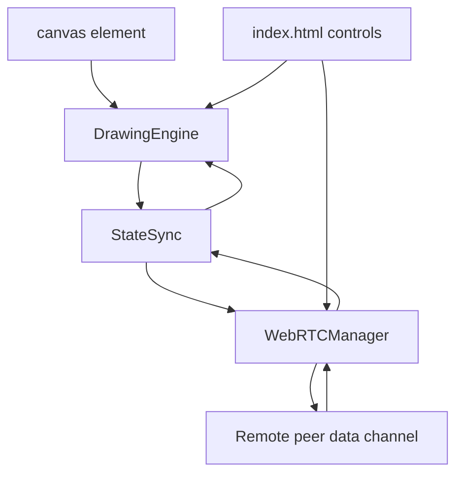

# P2P Collaborative Whiteboard - Architecture

## Overview

The P2P Collaborative Whiteboard is a serverless drawing surface that synchronizes strokes over a WebRTC data channel. Two peers exchange session descriptions manually, then draw together in real time. Each peer keeps a local canvas history for undo and redo.

The project is a static page with ES modules. There is no signaling server, account system, or persistence layer; the only network dependency is a public STUN server used during ICE negotiation.

## Purpose & Goals

- Demonstrate peer-to-peer communication without an application server.
- Keep the drawing loop responsive while remote strokes are applied.
- Provide predictable undo and redo for local drawing.
- Separate canvas rendering, message handling, and connection management so each can be tested or replaced independently.
- Make the manual signaling flow explicit enough to learn from, even though it is not suitable for production.

## Folder Structure

```text
collaborative-whiteboard/
|--  index.html          # Canvas, toolbar, and manual signaling fields
|--  style.css           # Responsive layout, theme colors, and toolbar styling
|--  drawing-engine.js   # Canvas rendering, brush settings, undo/redo history
|--  state-sync.js       # Command serialization and remote command handling
|--  webrtc-manager.js   # Peer connection, data channel, UI bootstrap
|--  ARCHITECTURE.md     # This document
`--  thumbnail.svg       # Preview thumbnail used by the project registry
```

## System / Project Architecture Overview

The application has three runtime layers. The drawing engine knows only about the canvas and local history. The state sync layer translates between engine calls and JSON commands. The WebRTC manager owns the peer connection and wires the layers together.



There is no central authority. Each peer applies its own local strokes immediately and broadcasts the same commands to the other side. Remote commands are applied without entering the local undo stack, which avoids echo loops.

## Component Breakdown

| Component       | Responsibility                                                                                                        |
| --------------- | --------------------------------------------------------------------------------------------------------------------- |
| `DrawingEngine` | Sizes the canvas, handles pointer input, draws segments, stores snapshots for undo/redo, and applies remote segments. |
| `StateSync`     | Builds `DRAW`, `SYNC`, and `CLEAR` commands, sends them, and dispatches incoming messages to the engine.              |
| `WebRTCManager` | Creates the `RTCPeerConnection`, exchanges SDP, manages the data channel, and reports connection state.               |
| `index.html`    | Provides the canvas, color and brush controls, undo/redo/clear buttons, and local and remote SDP text areas.          |
| `style.css`     | Defines the responsive workspace, toolbar, connection status, and light/dark palette.                                 |

## Data Flow / Execution Flow

1. `DOMContentLoaded` creates the `DrawingEngine`, the `WebRTCManager`, and a `StateSync` instance, then binds the toolbar.
2. The host presses Create Offer. `WebRTCManager` creates a data channel and an SDP offer, waits for ICE gathering, and writes the local description into the text area.
3. The host sends that SDP to the guest through an external channel such as chat.
4. The guest pastes the offer, presses Accept, and generates an answer. The host pastes the answer back and completes the connection.
5. When the data channel opens, the status indicator changes to connected.
6. A local pointer move draws a segment and calls `StateSync.sendDraw()` with the coordinates, color, and width.
7. The remote peer receives the JSON command, `StateSync` calls `engine.drawRemote()`, and the segment appears without touching the remote undo history.
8. Undo on the local peer restores a previous snapshot and broadcasts the current canvas as a `SYNC` command, so the other peer converges on the same image.
9. Clear broadcasts a `CLEAR` command after resetting the local canvas.

## Key Features

- **Serverless collaboration** - WebRTC data channels carry drawing commands directly between browsers.
- **Manual signaling** - Local and remote SDP text areas make the offer/answer exchange visible and debuggable.
- **Freehand drawing** - Mouse and touch events produce smooth line segments with configurable color and width.
- **Local undo and redo** - Snapshot history supports stepping backward and forward through local edits.
- **Remote-safe application** - Incoming segments bypass the local history so they cannot be undone accidentally.
- **State synchronization** - A full-canvas `SYNC` command resolves divergence after undo.
- **Canvas clear** - Clears the surface locally and notifies the peer.
- **Connection status** - The UI reports whether the data channel is open.

## Technologies Used

- HTML5 Canvas 2D API.
- WebRTC: `RTCPeerConnection`, `RTCDataChannel`, and ICE gathering.
- A public STUN server for NAT traversal.
- JSON message serialization.
- Vanilla ES6+ JavaScript modules.
- CSS custom properties for theming.

## File Responsibilities

### `index.html`

- Hosts the canvas and the color, brush size, undo, redo, and clear controls.
- Provides local and remote SDP text areas plus Create Offer, Accept, and Copy buttons.
- Shows the connection status and a short usage hint.
- Loads `webrtc-manager.js` as a module.

### `drawing-engine.js`

- **`resizeCanvas()`** - preserves the current image while resizing the backing store.
- **`startDrawing()` / `draw()` / `stopDrawing()`** - manage local pointer state and segment rendering.
- **`getCoordinates()`** - converts client coordinates into canvas space.
- **`drawSegment()`** - applies the current stroke style and draws a line.
- **`saveState()`** - pushes a `toDataURL` snapshot and truncates the redo branch.
- **`undo()` / `redo()`** - move the history pointer and restore the corresponding image.
- **`drawRemote()`** - renders a remote segment without saving local history.
- **`clear()`** - resets the canvas and history.

### `state-sync.js`

- **`sendDraw()`** - packages a segment as `{ type: "DRAW", payload: ... }`.
- **`sendClear()`** - broadcasts a clear action.
- **`broadcastUndo()`** - sends the current canvas snapshot as a `SYNC` command.
- **`handleMessage()`** - parses incoming JSON and dispatches `DRAW`, `SYNC`, or `CLEAR` to the engine.

### `webrtc-manager.js`

- **`WebRTCManager`** - wraps the peer connection, ICE configuration, and data channel.
- **`createOffer()`** - creates the channel and offer, then waits for ICE gathering.
- **`acceptConnection()`** - parses the remote description and creates an answer when needed.
- **`send()`** - guards against a missing or closed data channel.
- **Bootstrap** - creates the engine and sync objects and binds the toolbar and signaling controls.

### `style.css`

- Defines the two-column workspace and the responsive single-column layout.
- Styles the toolbar, color input, brush slider, and connection badge.
- Supplies the light and dark palettes used by the canvas background and UI.

### `thumbnail.svg`

- Static preview artwork for the project registry and not part of the runtime.

## Design Decisions

- **WebRTC data channel over WebSocket**: A data channel keeps the app serverless and demonstrates NAT traversal, at the cost of manual signaling.
- **Snapshot history**: Storing `toDataURL` snapshots is simple and reliable for a prototype. A command log would use less memory but requires more bookkeeping.
- **Remote draws skip history**: Only local actions enter the undo stack. This prevents one peer from undoing another peer's work.
- **Full-state undo sync**: Sending the whole canvas after undo is bandwidth-heavy but avoids implementing a CRDT or inverse commands.
- **Explicit signaling UI**: Exposing SDP makes the connection process transparent and avoids hiding a server dependency.
- **Layer boundaries**: The engine has no network code, and the WebRTC manager has no drawing logic. The sync layer is the only bridge.

## Dependencies

| Dependency              | Version          | How loaded    | Purpose                             |
| ----------------------- | ---------------- | ------------- | ----------------------------------- |
| Browser runtime         | Modern evergreen | Native        | WebRTC, canvas, modules             |
| Public STUN server      | n/a              | Network       | ICE candidate discovery             |
| Cradle project registry | n/a              | Local tooling | Discovers the project and thumbnail |

The project has no npm packages, CDN scripts, fonts, or backend. A TURN server would be required for peers behind symmetric NATs in real deployments.

## Future Improvements

- Add an automatic signaling channel using WebSocket or a shareable room code.
- Replace snapshot history with an operation log and inverse commands.
- Add collaborative cursors and presence indicators.
- Support an eraser tool and shape primitives.
- Compress `SYNC` payloads and send incremental snapshots.
- Add reconnection handling and data channel health checks.
- Persist the board in IndexedDB for local recovery.

## Known Limitations

- Signaling is manual and requires copying large SDP strings between peers.
- Only two peers are supported; there is no room or mesh management.
- Undo synchronization sends a full PNG data URL, which grows with canvas size.
- Redo is local only; the remote peer is not notified when a local redo restores an older snapshot.
- There is no conflict resolution beyond last-write-wins full-state sync.
- The public STUN server is a demo dependency and does not guarantee connectivity.
- The board is not persisted after a reload.
- There is no authentication or transport encryption beyond what WebRTC provides by default.

## Development Notes

- Serve the folder over HTTP. ES modules and WebRTC APIs are restricted on `file://` in most browsers.
- Both peers must use a modern browser with WebRTC support. Check `RTCPeerConnection` before debugging signaling.
- ICE gathering can take a few seconds. The offer and answer are only complete after gathering finishes.
- Keep `DRAW` payloads small. Coordinates are in canvas pixels, so both peers should use the same canvas dimensions.
- The engine's history pointer and length must stay consistent when adding new commands. Review `saveState()`, `undo()`, and `redo()` together.
- Run `npm run validate:architecture` from the repository root after editing this file.

## License & Attribution

- **Project License:** MIT, inherited from the Cradle repository.
- **Third-Party Assets:** None. The drawing engine and signaling UI are original to the project.

## References

- [MDN: WebRTC API](https://developer.mozilla.org/en-US/docs/Web/API/WebRTC_API)
- [MDN: RTCPeerConnection](https://developer.mozilla.org/en-US/docs/Web/API/RTCPeerConnection)
- [MDN: RTCDataChannel](https://developer.mozilla.org/en-US/docs/Web/API/RTCDataChannel)
- [MDN: Canvas API](https://developer.mozilla.org/en-US/docs/Web/API/Canvas_API)
- [Cradle contribution guide](../../../CONTRIBUTING.md)
