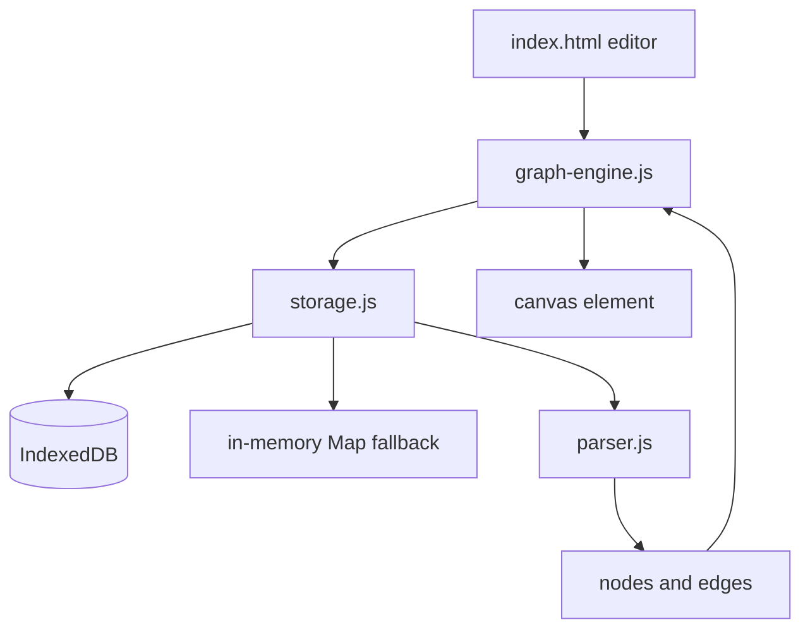

# Local-First Markdown Knowledge Graph - Architecture

## Overview

The Local-First Markdown Knowledge Graph is a note editor that turns `[[wikilinks]]` into an interactive force-directed graph. Notes are stored in IndexedDB when available, with an in-memory `Map` fallback for private browsing or blocked storage. The graph is drawn on a canvas by a small custom physics engine with pan, zoom, and node dragging.

The project is a static page with ES modules. It has no backend, no account model, and no external visualization library.

## Purpose & Goals

- Provide a frictionless way to connect notes without a server.
- Parse wiki-style links into a node and edge model that can be visualized immediately.
- Degrade to in-memory storage when IndexedDB is unavailable instead of failing to start.
- Demonstrate a dependency-free force simulation that remains readable.
- Keep editing, parsing, storage, and rendering in separate modules.

## Folder Structure

```text
knowledge-graph/
|--  index.html          # Split-pane editor and graph canvas
|--  style.css           # Responsive layout, theme colors, and panel styling
|--  storage.js          # IndexedDB wrapper with an in-memory fallback
|--  parser.js           # Wikilink extraction and graph construction
|--  graph-engine.js     # Force simulation, canvas renderer, and UI bootstrap
|--  ARCHITECTURE.md     # This document
`--  thumbnail.svg       # Preview thumbnail used by the project registry
```

## System / Project Architecture Overview

The data path is linear: storage returns notes, the parser turns notes into nodes and edges, and the graph engine owns both the physics state and the canvas. The editor is a thin client over the same storage layer.



`GraphEngine` is the only module with a DOM dependency. `GraphParser` is stateless and static. `StorageManager` hides the difference between IndexedDB and the fallback behind one async API.

## Component Breakdown

| Component        | Responsibility                                                                                                              |
| ---------------- | --------------------------------------------------------------------------------------------------------------------------- |
| `StorageManager` | Opens the database, creates the object store, and exposes CRUD methods with a memory fallback.                              |
| `GraphParser`    | Builds node objects from note titles and edges from `[[wikilink]]` matches, including links to notes that do not exist yet. |
| `GraphEngine`    | Loads notes, assigns positions, runs the force simulation, renders the canvas, and handles pan, zoom, and drag.             |
| `index.html`     | Provides the note list, title and content fields, save and delete controls, and the graph canvas.                           |
| `style.css`      | Defines the split-pane layout, responsive stacking, and light/dark palette.                                                 |

## Data Flow / Execution Flow

1. `StorageManager` is constructed and starts `init()` immediately. It opens `CradleKnowledgeGraphDB` and marks IndexedDB as available, or falls back to the in-memory map.
2. On `DOMContentLoaded`, `graph-engine.js` creates a `GraphEngine`, binds the editor controls, and calls `loadData()`.
3. `loadData()` asks storage for every note and passes the array to `GraphParser.parse()`.
4. The parser creates one node per note title, adds placeholder nodes for link targets that have no note, and records unique directed edges.
5. Nodes with no position receive a random offset around the canvas center. The simulation begins on the next animation frame.
6. Each frame applies repulsion between node pairs, spring attraction along edges, and a centering force, then integrates velocity with damping.
7. The renderer clears the canvas, applies the pan and zoom transform, draws edges, and draws nodes with labels. The selected node is highlighted.
8. Typing in the editor is debounced. A save writes the note and then reloads the graph so new links appear.
9. Delete removes the note from storage and reloads the graph, leaving any placeholder nodes that are still referenced.

## Key Features

- **Wikilink parsing** - `[[Note Title]]` references become directed edges.
- **Placeholder nodes** - Links to notes that do not exist yet still appear in the graph, which makes gaps visible.
- **Local-first persistence** - IndexedDB is used when available; an in-memory map keeps the app usable when it is not.
- **Custom force simulation** - Repulsion, spring attraction, centering, and damping are implemented without a physics library.
- **Pan and zoom** - The canvas transform supports wheel zoom and background dragging.
- **Node dragging** - Dragging a node pins it under the pointer and updates the simulation.
- **Note list navigation** - Clicking a note loads it into the editor.
- **Debounced auto-save** - Edits are written shortly after typing stops rather than on every keystroke.
- **Theme support** - Colors are read from CSS custom properties so light and dark modes stay consistent.

## Technologies Used

- IndexedDB for persistent local storage.
- HTML5 Canvas 2D API for graph rendering.
- `requestAnimationFrame` for the simulation loop.
- Vanilla ES6+ JavaScript with classes and native modules.
- CSS flexbox and custom properties for layout and theming.

## File Responsibilities

### `index.html`

- Declares the left pane with the note list and editor fields.
- Declares the right pane with the canvas and graph controls.
- Provides Save, New, Delete, and Reset View buttons.
- Loads `graph-engine.js` as a module.

### `storage.js`

- **`init()`** - detects IndexedDB and opens the database, falling back on failure.
- **`openDB()`** - creates the `notes` object store with `id` as the key path.
- **`saveNote()` / `getAllNotes()` / `getNote()` / `deleteNote()`** - route each operation to IndexedDB or the memory map.
- The fallback is intentionally complete, so callers do not need to branch on storage availability.

### `parser.js`

- **`GraphParser.parse(notes)`** - returns `{ nodes, edges }`.
- Deduplicates edges by source and target.
- Trims whitespace inside link brackets.
- Creates placeholder nodes for missing targets.
- Resets positions to zero; the engine decides where new nodes start.

### `graph-engine.js`

- **`GraphEngine`** - owns the canvas, transform, node arrays, and interaction state.
- **`loadData()`** - reads notes, parses the graph, and assigns initial positions.
- **`updateNoteList()`** - renders the sidebar and loads a note into the editor on click.
- **`setupInteractions()`** - handles pan, zoom, node drag, and selection.
- **`animate()`** - runs one physics step and one render pass per frame.
- **`render()`** - draws edges, nodes, labels, and the selected state.
- **Bootstrap** - creates the storage and engine objects and binds Save, New, Delete, and Reset View.

### `style.css`

- Provides the two-pane flex layout and the responsive stack for narrow screens.
- Styles the note list, form fields, buttons, and canvas frame.
- Defines the node, edge, label, and selection colors used by the renderer.

### `thumbnail.svg`

- Static preview artwork for the project registry and not part of the application.

## Design Decisions

- **Custom physics instead of D3**: Repulsion, springs, and damping are simple enough to implement directly, and avoiding a large dependency keeps the project inspectable.
- **Placeholder nodes**: Creating nodes for missing targets turns broken links into visible prompts rather than silently dropping them.
- **Storage abstraction**: The rest of the app calls the same async methods regardless of whether IndexedDB is available, which keeps private-browsing behavior graceful.
- **Canvas instead of SVG**: A canvas avoids creating a DOM node per element and keeps rendering predictable as the graph grows.
- **Debounced save**: Waiting after the last keystroke reduces write pressure while still persisting promptly.
- **Zero positions as a sentinel**: The parser leaves `x` and `y` at zero, and the engine assigns a random start only when both are still zero.

## Dependencies

| Dependency              | Version          | How loaded    | Purpose                             |
| ----------------------- | ---------------- | ------------- | ----------------------------------- |
| Browser runtime         | Modern evergreen | Native        | IndexedDB, canvas, modules          |
| Cradle project registry | n/a              | Local tooling | Discovers the project and thumbnail |

There are no npm packages, CDN scripts, fonts, or external services. IndexedDB availability depends on the browser and privacy mode.

## Future Improvements

- Persist node positions so the layout is stable across reloads.
- Add a proper initial layout, such as a circle or grid, instead of random offsets.
- Add search and filtering for large graphs.
- Support backlinks and an inspector panel for the selected node.
- Add arrowheads and edge labels for directed relationships.
- Export and import the note collection as JSON or Markdown.
- Run the simulation only while nodes are moving to reduce idle CPU use.
- Add tests for parser deduplication and placeholder creation.

## Known Limitations

- Node positions are not persisted. Reloading the page produces a new random layout.
- Initial positions are random offsets around the origin, which can leave the graph off-center before the simulation settles.
- The parser uses a regular expression and does not understand code fences or escaped brackets.
- Renaming a note does not rewrite incoming links, so old targets become placeholder nodes.
- The graph has no viewport culling; very large note collections will slow the render loop.
- IndexedDB writes are not transactional across multiple notes.
- The in-memory fallback loses all notes when the tab closes.
- There is no conflict handling because the app is single-tab and local by design.

## Development Notes

- Serve the folder over HTTP. Native modules and IndexedDB behave inconsistently on `file://`.
- Note IDs are titles. Keep that invariant when adding rename support, or migrate existing links deliberately.
- The parser returns zero positions by design. Do not assign positions there unless the engine contract changes.
- The simulation reads `canvas.width` and `canvas.height`; resize handling must update both before the next frame.
- Use `storage.getAllNotes()` as the single source of truth after a mutation, then reparse. Partial in-memory graph updates are easy to get wrong.
- Run `npm run validate:architecture` from the repository root after editing this file.

## License & Attribution

- **Project License:** MIT, inherited from the Cradle repository.
- **Third-Party Assets:** None. The parser, physics loop, and thumbnail are original to the project.

## References

- [MDN: IndexedDB API](https://developer.mozilla.org/en-US/docs/Web/API/IndexedDB_API)
- [MDN: Canvas API](https://developer.mozilla.org/en-US/docs/Web/API/Canvas_API)
- [Force-directed graph drawing](https://en.wikipedia.org/wiki/Force-directed_graph_drawing)
- [Cradle contribution guide](../../../CONTRIBUTING.md)
