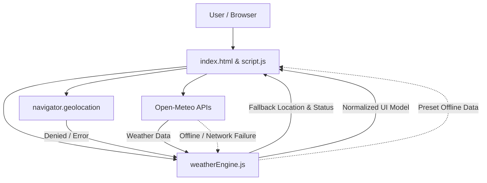

# Weather - Architecture

## Overview

The Weather mini is a responsive weather application delivering real-time meteorological conditions, temperature unit conversion (°C/°F), and a 5-day daily forecast. It features geolocation-aware weather discovery paired with robust permission denial handling, manual city search fallbacks, and offline weather presets.

The mini runs client-side using evergreen browser standards and the keyless Open-Meteo public API, with zero build steps or secret credentials.

## Purpose & Goals

- Provide instant access to current temperature, humidity, wind speed, pressure, and multi-day forecasts.
- Gracefully handle geolocation denial without showing a blank or broken user interface.
- Offer manual search by city or postcode when location permissions are denied or unavailable.
- Maintain full offline and mock resilience with bundled preset meteorological data.
- Meet Cradle mini-project architectural contracts for security, accessibility, and zero-dependency runtime.

## Folder Structure

```text
projects/productivity/weather/
|-- index.html          # HTML entrypoint, search form, status banner, weather cards
|-- style.css           # Responsive styles, theme variables, focus indicators
|-- weatherEngine.js    # Pure logic: WMO code mapping, unit math, geolocation error handling
|-- script.js           # UI controller: DOM binding, Geolocation API, Open-Meteo fetch
|-- thumbnail.svg       # Project card preview art
`-- ARCHITECTURE.md     # This document
```

## System / Project Architecture Overview

The mini follows a clean two-layer structure separating pure computational and translation logic from DOM and browser lifecycle management.



## Component Breakdown

| Component          | Responsibility                                                                                                     |
| ------------------ | ------------------------------------------------------------------------------------------------------------------ |
| `index.html`       | Provides document structure, search bar, status banner, current conditions card, and 5-day forecast grid.          |
| `weatherEngine.js` | Parses raw API responses, formats temperatures, maps WMO weather codes, and handles geolocation permission errors. |
| `script.js`        | Manages browser events, geolocation requests, geocoding search, Open-Meteo network fetches, and DOM rendering.     |
| `style.css`        | Defines light and dark mode custom properties, responsive layout, status banners, and accessible focus outlines.   |
| `thumbnail.svg`    | Project thumbnail for the Cradle registry.                                                                         |

## Data Flow / Execution Flow

1. On load (`DOMContentLoaded`), `requestGeolocation()` invokes `navigator.geolocation.getCurrentPosition()`.
2. **Permission Granted**: Coordinates (`latitude`, `longitude`) are resolved and sent to `fetchWeather()`.
3. **Permission Denied**:
   - The error callback invokes `handleGeolocationError(error)`.
   - The status banner displays `"Location access denied."` with instructions.
   - The manual city search input is focused for immediate keyboard interaction.
   - Default weather for London (51.5074, -0.1278) is immediately loaded, ensuring the UI is never blank.
4. **Manual Search**: User enters a city name or clicks a quick chip; `searchCity()` queries Open-Meteo Geocoding API and loads matching weather.
5. **Offline Fallback**: If network requests fail or the device is offline, bundled preset weather data for common cities is returned seamlessly.
6. **Unit Toggle**: Clicking the `°C / °F` button recalculates and updates all temperatures in place.

## Key Features

- **Geolocation with Safe Denial Fallback**: Full error callback implementation that notifies the user and defaults to London weather instead of a blank screen.
- **Manual City Search**: Instant geocoding search supporting worldwide cities and postcodes.
- **5-Day Weather Forecast**: Minimum/maximum temperatures, weather condition icons, and daily summaries.
- **Unit Conversion**: Instant toggle between Celsius and Fahrenheit.
- **Zero Credentials / Keyless API**: Uses the open Open-Meteo public API with no API keys or secret tokens.
- **Offline & Mock Resilience**: Bundled presets for London, New York, Tokyo, Paris, and Sydney guarantee functionality without an internet connection.
- **Accessibility**: Semantic HTML, ARIA alerts for status messages, and WCAG 2.1 visible focus states.

## Technologies Used

- HTML5 semantic elements and Canvas/SVG.
- CSS Custom Properties and Flexbox/Grid.
- Modern JavaScript (ES6+ modules).
- W3C Geolocation API (`navigator.geolocation`).
- Open-Meteo Forecast & Geocoding REST APIs.

## File Responsibilities

### `index.html`

- Contains the entrypoint markup, search input form, status banner, current weather view, and forecast grid.
- Includes the shared Cradle favicon and `BackToHome` navigation script.

### `weatherEngine.js`

- **`handleGeolocationError(error)`**: Standardizes geolocation denial error codes into actionable user messages and returns default fallback coordinates.
- **`parseWeatherData(apiData, locationName)`**: Transforms Open-Meteo payloads into clean UI data objects.
- **`getWeatherCondition(wmoCode)`**: Maps WMO meteorological codes (0–99) to human-readable strings and emoji weather icons.
- **`celsiusToFahrenheit()` / `formatTemperature()`**: Handles temperature conversions.
- **`findPresetLocation(query)`**: Looks up offline preset coordinates and weather mock data.

### `script.js`

- Orchestrates event listeners for search submissions, location requests, unit toggling, and preset chips.
- Dispatches fetch requests with abort timeout controllers.
- Updates DOM elements with structured weather data.

### `style.css`

- Implements a responsive mobile-first grid layout.
- Provides accessible color contrast for light and dark color schemes.

## Design Decisions

- **Open-Meteo over Key-gated APIs**: Open-Meteo requires no API key, adhering strictly to Cradle's `CREDENTIALS_AND_SECRETS.md` policy.
- **Synchronous Default Fallback on Denial**: Immediately displaying London weather upon permission denial prevents layout shift and guarantees users never experience an empty or broken interface.
- **Separation of Engine Logic**: Isolating parsing and unit math in `weatherEngine.js` enables 100% headless unit test coverage without browser DOM dependencies.

## Dependencies

| Dependency              | Version | How loaded    | Purpose                            |
| ----------------------- | ------- | ------------- | ---------------------------------- |
| Open-Meteo Forecast API | v1      | Fetch / HTTPS | Live weather conditions & forecast |
| Open-Meteo Geocode API  | v1      | Fetch / HTTPS | City name to latitude/longitude    |
| Cradle project registry | n/a     | Local tooling | Discovery and catalog listing      |

No npm packages, build tools, or third-party client libraries are used.

## Future Improvements

- Add hourly temperature and precipitation graphs.
- Cache recent searches in `CradleStorage`.
- Support wind direction compass indicator.
- Support radar / satellite map overlay.

## Known Limitations

- Live weather and geocoding require an active internet connection; otherwise, cached preset cities are displayed.
- Geolocation precision depends on the user's browser, network provider, and operating system.

## Development Notes

- Serve the project over HTTP (e.g. `npm run dev`) since browsers restrict geolocation and ES modules over `file://`.
- Run `npm run validate:mini-contract` and `npm run validate:architecture` to verify compliance.
- Run `node --test tests/weather.test.js` to execute unit tests.

## License & Attribution

- **Project License:** MIT, inherited from the Cradle repository.
- **Third-Party Services:** Meteorological data provided by [Open-Meteo](https://open-meteo.com) under CC BY 4.0.

## References

- [W3C Geolocation API Specification](https://www.w3.org/TR/geolocation/)
- [Open-Meteo API Documentation](https://open-meteo.com/en/docs)
- [WMO Weather Interpretation Codes](https://www.nodc.noaa.gov/archive/arc0021/0002199/1.1/data/0-data/HTML/WMO-CODE/WMO4677.HTM)
- [Cradle contribution guide](../../../CONTRIBUTING.md)
